<h1 align="center">Hey, I’m Rayyan 👋</h1>

  

I’m a **Computer Science and Quantitative Economics** student at **Dickinson College** (’29). At the [Deep Network Understanding Lab](https://dnulab.org/), I study how language models use tools and what happens when those tools encounter untrusted text. I also tutor Python and quantitative reasoning at Dickinson.

I’m also interested in fintech and how payment systems work.

### Research

- **[Prompt injection in Minecraft](https://github.com/R1Kexpress/mc-tool)** · Built an LLM agent and evaluated indirect prompt injection across **180 episodes**. A tool lock prevented diamond loss in **20/20 explicit-override trials**. With the lock, control-task completion fell from **20/20 to 14/20**.
- **[DistilGPT-2 tool calling and memory](https://dnulab.org/student-reports/spring2026/madraswala.pdf)** · Fine-tuned DistilGPT-2 to decide when to call a calculator and when to reuse a cached result. The pipeline reached **73.8% exact-match execution** across **16,000 multi-digit operations**.

### Hackathon projects

- **[Aman](https://github.com/R1Kexpress/HackPSU)** · Offline web app and multilingual Telegram bot for pediatric screening in low-connectivity settings. Gemini extracts facts from voice input, and a rules engine determines the triage category. [HackPSU demo](https://devpost.com/software/aman-asuz3e)
- **[Resume Roaster](https://github.com/R1Kexpress/resume-roaster)** · A Flask app that reads résumé PDFs and turns Gemini critiques into spoken roasts with ElevenLabs. Won **Best Use of AI** at Dickinson’s Red Devil Hacks.

### Tools I use

### GitHub activity

  <picture>
    <source media="(prefers-color-scheme: dark)" srcset="https://raw.githubusercontent.com/R1Kexpress/R1Kexpress/profile-assets/stats-dark.svg" />
    
  </picture>

<a href="https://www.linkedin.com/in/rayyan-madraswala-56630a376/">LinkedIn</a> · <a href="mailto:rayyanfaizm@gmail.com">Email</a>

